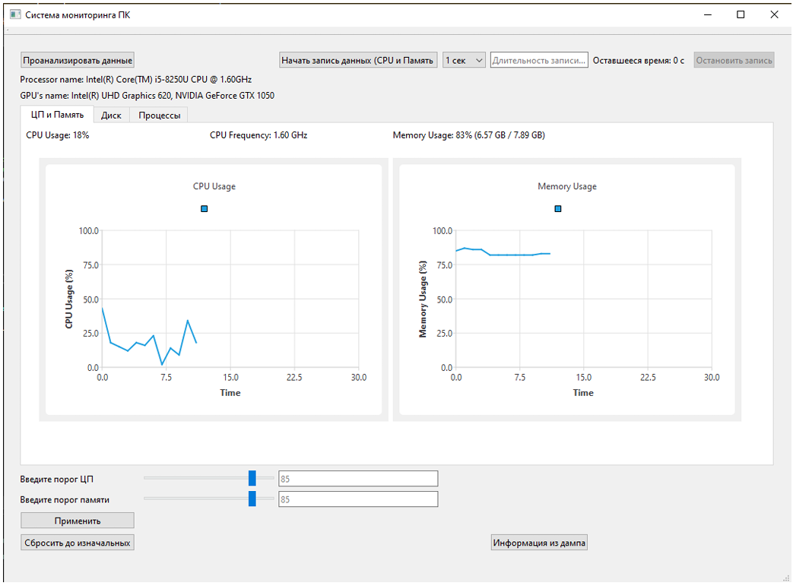
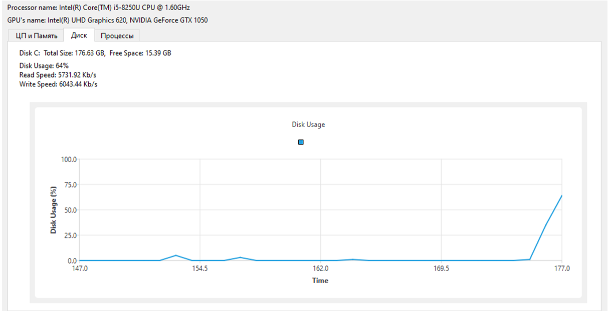
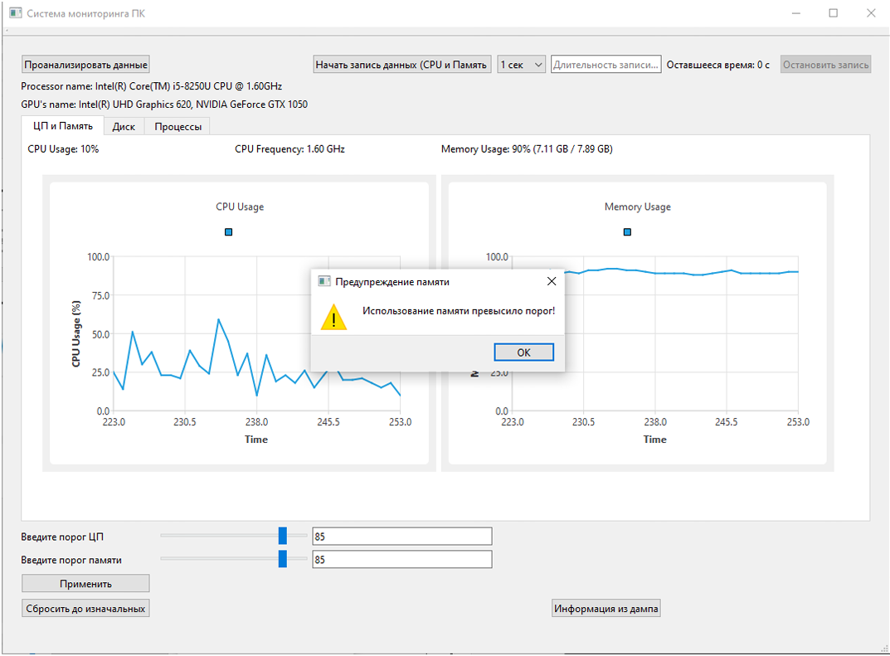
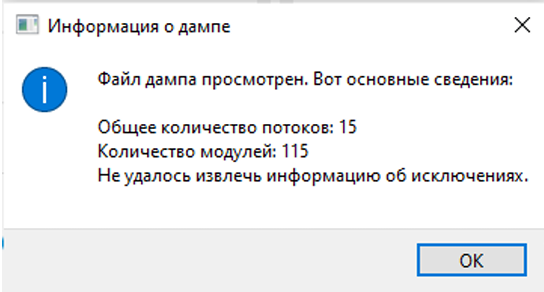
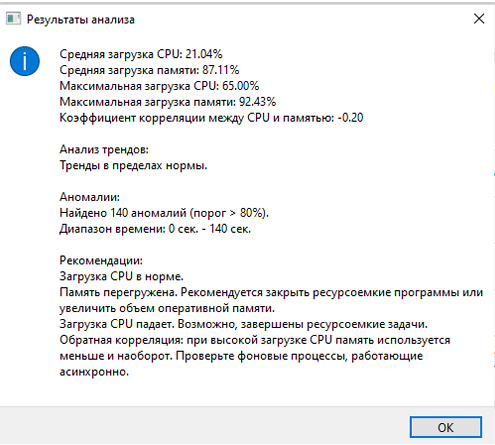

# Мониторинг производительности ПК

Десктопное приложение для Windows, которое в реальном времени отслеживает ключевые показатели работы компьютера. Данные собираются через WMI и WinAPI, визуализируются графиками Qt Charts, пишутся в CSV и разбираются встроенным модулем анализа с выдачей рекомендаций. При превышении пороговых значений приложение уведомляет пользователя и создаёт дамп памяти для диагностики.

## Возможности

- Загрузка ЦП, использование ОЗУ (в процентах и гигабайтах), скорость чтения/записи и активное время диска в реальном времени
- Информация о процессоре и графических процессорах, тактовой частоте, объёме и свободном месте основного диска
- Графики в реальном времени на Qt Charts (ЦП, память, диск)
- Сбор данных в отдельном потоке, интерфейс не блокируется
- Настраиваемые пороги ЦП и памяти с всплывающими уведомлениями (кулдаун 30 секунд)
- Автоматическое создание дампа памяти при одновременном превышении обоих порогов, просмотр информации о дампе
- Логирование в CSV: постоянный фоновый лог и пользовательская запись с настраиваемым интервалом и длительностью
- Анализ логов: средние и максимальные значения, аномалии, корреляция, тренды и рекомендации по оптимизации
- Список активных процессов

## Стек

- Язык: C++17
- Интерфейс: Qt Widgets и Qt Charts
- Системные данные: Windows Management Instrumentation (WMI), WinAPI
- Диагностика: `MiniDumpWriteDump` (`dbghelp`)
- Среда разработки: Visual Studio 2022
- ОС: Windows 10/11

## Скриншоты

| Главное окно | Данные диска |
|---|---|
|  |  |

| Уведомление о превышении порога | Информация о дампе |
|---|---|
|  |  |

| Результат анализа лога |
|---|
|  |

## Сборка

Требования:

- Windows 10/11
- Visual Studio 2022 с компонентом «Разработка классических приложений на C++»
- Qt (MSVC-сборка) с модулем Qt Charts
- Расширение Qt VS Tools

Шаги:

1. Установить Qt и расширение Qt VS Tools для Visual Studio.
2. В Qt VS Tools указать путь к установленному Qt (раздел Qt Versions).
3. Открыть файл `kursov_SP.sln` в Visual Studio 2022.
4. Проверить, что в свойствах проекта выбран нужный Qt-кит, и собрать конфигурацию `Release | x64`.

Точная версия Qt в проекте не зафиксирована, при первой сборке может потребоваться указать установленный кит в свойствах проекта.

## Использование

1. Запустить приложение — показатели обновляются автоматически.
2. Задать пороги ЦП и памяти ползунками и нажать «Применить» (или «Сбросить» для значений по умолчанию).
3. При превышении порога появляется уведомление; если превышены оба порога одновременно, автоматически создаётся дамп памяти.
4. Кнопка «Проанализировать данные» позволяет выбрать `.csv`-лог и получить статистику с рекомендациями.
5. Настроить интервал и длительность записи в файл для выгрузки данных.

## Тестирование

Работа приложения проверялась сравнением с Диспетчером задач Windows:

- проценты загрузки ЦП и памяти совпадают в пределах нормального расхождения из-за разной частоты обновления;
- активное время диска совпадает;
- скорости чтения и записи немного отличаются из-за разного интервала опроса.
